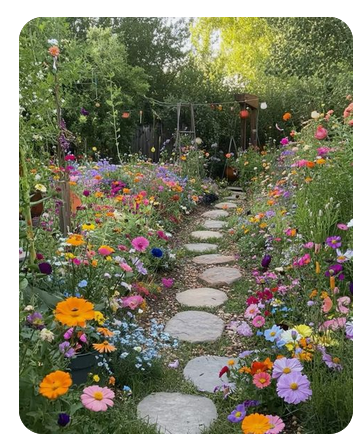

# Title of Document 

## Subheading

### Sub-Subheading

*This* is a **markdown** ***file***. All of these are done with varying levels of asterix * Double click the word or words then type asterics 

> A Quotation is done with the > symbol

My favourite command is `ls`. This was created using a "Back tick" which looks like `. ls is a commant that list's the file path 

```
This is a code block created using three back ticks in a row ``` you type them in, enter to the next line then close on the next line with three more. The core is then shareable in a chat
```
- To Create a list 
- Just use - then space then type 
    - To create a sub item it is tab then the -
- To go back a level shift and tab then - 

Inserting a link to the [(cheatsheet)](https://macodrum-c4dh-docs.netlify.app/
)
This was done using a [ ] on either side of the selected word then parenthesis besides it () with the link inside 

Here is an image


You could also add an immage from your desktop using exclamation point (!) [Description]and right beside it (link) where the link is the file description. If the image is in the same file as your note (this) you just need to put the file name 



