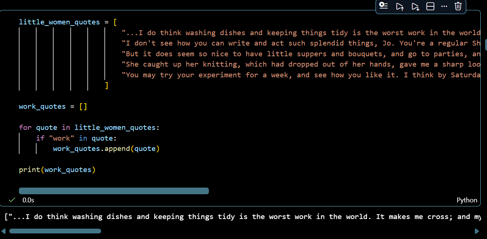

In class activity - THIS WAS A FAILED Attempt there are additional things needed for this to work rip
First defining the bucket > menu = ["Mlktea", "Mint", "Cereal", "Sesame", "Coffee", "ChocoV", "PassfV"]
```
menu = ["Mlktea", "Mint", "Cereal", "Sesame", "Coffee", "ChocoV", "PassfV"]
Milktea = 0
Mint = 1
Cereal = 2 
Sesame = 3
Coffee = 4
ChocoV = 5 
PassfV = 6 

```
Then create the code to identify what you want in a loop. For this example I am trying to select ChocoV so below will be the steps.

for icecream in menu:
    if icecream == 5 print (word)

This is the correct way to do this with a different example 


